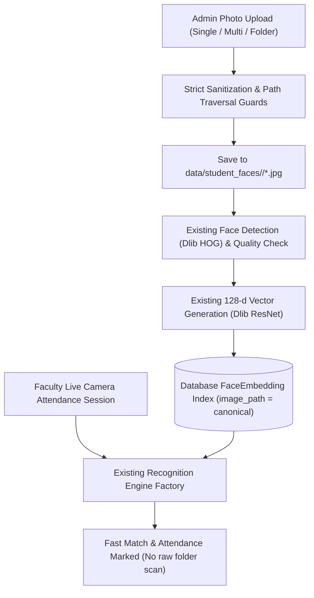

# PHASE 7.8 — CANONICAL STUDENT FACE DATASET & MULTI-PHOTO ADMIN ENROLLMENT

**Project:** Attendance Marker  
**Repository:** `am-oss`  
**Git Branch:** `feat/phase-7-8-canonical-student-face-dataset`  
**Date:** October 5, 2026  
**Status:** ✅ Complete, Verified, & Production-Ready  

---

## 1. Executive Summary

Phase 7.8 establishes a canonical, structured file storage repository for student face images while retaining high-performance, real-time face recognition via precomputed database biometric embeddings. 

Prior to Phase 7.8, face recognition operated purely on ad-hoc uploaded image paths or temporary files. Phase 7.8 introduces a permanent, organized directory structure:
```
data/student_faces/<register_number>/photo_xxx.jpg
```
where **the folder name is the student's register number / authoritative identity key**. Filenames remain strictly non-authoritative identifiers. Runtime recognition continues to query the optimized `FaceEmbedding` table without scanning file folders on every recognition request, fully preserving millisecond-level attendance processing.

Additionally, Phase 7.8 delivers full **Multi-Photo Admin Enrollment** across both the **Flutter Mobile/Desktop Client** and the **Web Administrator Console**, empowering administrators to upload 1–N photos simultaneously, preview the dataset gallery, stream authenticated thumbnails, delete individual photos without wiping an entire profile, and replace entire datasets with clear confirmation guards.

---

## 2. Architecture & Design Principles



### Key Architectural Tenets
1. **Canonical File Storage:**
   - Permanent master image storage at `data/student_faces/<register_number>/`.
   - Never exposed as an unauthenticated static web folder.
   - Protected from git commits via `.gitignore` (`data/student_faces/` and `data/demo/`).
2. **Identity authoritativeness:**
   - Identity = Student Register Number (`roll_number`).
   - Image filename = Irrelevant to identity (e.g., `camera_1.jpg`, `WhatsApp Image.jpeg`, or `photo_001.jpg` all belong strictly to the enclosing folder's register number).
3. **High-Performance Runtime Recognition:**
   - Faculty sessions query `FaceEmbedding` vectors directly in memory / SQL index.
   - Live camera attendance **never** scans raw JPG files across the file system during live sessions.
4. **Duplicate Protection:**
   - SHA-256 content hashing blocks bit-for-bit duplicate files.
   - Euclidean vector distance (< 0.03) guards against near-identical repeated frames.
5. **Partial Failure Tolerance:**
   - Multi-photo upload batches report individual item statuses (`ENROLLED`, `REJECTED_NO_FACE`, `REJECTED_MULTI_FACE`, `SKIPPED_DUPLICATE`, `SKIPPED_NOT_AN_IMAGE`). Valid photos are enrolled even if some photos fail.

---

## 3. Backend Implementation Details

### 3.1 Dataset Storage Service (`app/services/face_dataset_service.py`)
- `ensure_dataset_root()`: Creates root `data/student_faces/` safely.
- `sanitize_roll_number()`: Rejects path traversal (`..`, `/`, `\`) and restricts identifiers to alphanumeric characters, dashes, and underscores.
- `sanitize_filename()`: Normalizes uploaded filenames and strips dangerous path characters.
- `save_student_face_image()`: Writes incoming photo bytes to `data/student_faces/<roll_number>/<safe_name>`, automatically resolving filename collisions with numeric suffixes.
- `check_duplicate_photo()`: Validates file SHA-256 and checks existing embeddings for near-identical duplicate vectors.
- `delete_student_photo_file()` & `clear_student_photos_dir()`: Manages physical file cleanup upon individual photo deletion or dataset reset/replacement.

### 3.2 Configuration Updates (`app/core/config.py`)
- `STUDENT_FACE_DATASET_DIR: str = os.getenv("STUDENT_FACE_DATASET_DIR", "data/student_faces")`
- Property `student_face_dataset_path` resolves the absolute path to the dataset directory.

### 3.3 API Endpoints (`app/api/admin_enrollment.py`)
1. **Multi-Photo Enrollment:**
   `POST /api/v1/admin/students/{student_id}/enroll-photos?replace=false`
   - Accepts multipart file upload with multiple files under the key `files`.
   - Returns structured `MultiPhotoEnrollmentResponse` with total, enrolled, rejected, and per-file status breakdown.
2. **Dataset Metadata Inspection:**
   `GET /api/v1/admin/students/{student_id}/photos`
   - Returns roll number, full name, class section, photo count, template count, and array of photo items (`embedding_id`, `filename`, `image_path`, `created_at`, `quality_score`).
3. **Authenticated Image File Streamer:**
   `GET /api/v1/admin/students/{student_id}/photos/{embedding_id}/image`
   - Requires Administrator authorization token.
   - Verifies path safety and serves the image with MIME type detection.
4. **Individual Photo Deletion:**
   `DELETE /api/v1/admin/students/{student_id}/photos/{embedding_id}`
   - Removes both physical file in `data/student_faces/<roll_number>/` and database `FaceEmbedding` record.
   - If other photos remain, student enrollment status remains intact.
5. **Replace Dataset Endpoint:**
   `POST /api/v1/admin/students/{student_id}/replace-dataset`
   - Atomically clears previous photos and templates before enrolling the new set.

---

## 4. Frontend Implementation Details

### 4.1 Flutter Mobile / Desktop Client (`mobile/`)
- **API Client & Models (`mobile/lib/core/network/api_client.dart`, `mobile/lib/models/admin_biometric_model.dart`):**
  - Added `multipartPostMultipleFilesBytes` to transmit multiple images concurrently.
  - Added `getBytes` to securely fetch authenticated binary image data.
  - Added models: `StudentPhotoItemModel`, `StudentDatasetViewModel`, `MultiPhotoResultItemModel`, and `MultiPhotoEnrollResponseModel`.
- **Admin Service (`mobile/lib/services/admin_service.dart`):**
  - Implemented `enrollStudentPhotos()`, `fetchStudentDataset()`, `fetchStudentPhotoImageBytes()`, and `deleteStudentPhoto()`.
- **Admin Biometrics Screen (`mobile/lib/admin/screens/admin_student_face_screen.dart`):**
  - Enhanced `_StudentDetailsSheet` with **[View Face Dataset]**, **[Enroll Multiple Photos]**, **[Replace]**, and **[Delete]** actions.
  - Implemented `_StudentDatasetDialog`: Modal displaying canonical folder path, photo count, active template count, and responsive photo grid.
  - Implemented `_StudentPhotoThumbnail`: Asynchronously loads and renders image bytes via authenticated API, displaying filename, quality score, zoom modal, and individual trash button.
  - Implemented `_MultiPhotoResultDialog`: Presents clear summary pills and a status breakdown list for batch uploads.

### 4.2 Web Administrator Console (`app/static/js/admin_app.js` & `app/templates/admin_panel.html`)
- **Biometrics Table:** Added **Dataset** (`btn-outline-info`) and **Upload** (`btn-outline-primary`) buttons to each student row.
- **Dataset Modal (`openStudentDatasetModal`):**
  - Displays student header, canonical folder path `data/student_faces/<roll_number>/`, and stats.
  - Thumbnail gallery with live image streamers and per-photo delete buttons.
- **Multi-Photo Upload Modal (`openAdminMultiEnrollModal`):**
  - Multi-file selector for JPEG/PNG images.
  - Supports both additive upload and dataset replacement.
  - Renders detailed results table with status badges (`ENROLLED`, `REJECTED_NO_FACE`, `SKIPPED_DUPLICATE`).

---

## 5. Verification & Test Execution Matrix

### 5.1 Backend Pytest Suite
Ran: `$env:PYTHONPATH='.'; .venv\Scripts\python.exe -m pytest tests/test_admin_face_enrollment.py tests/test_phase_7_8_dataset_and_multi_photo.py -v`
- **Result:** **23 / 23 PASSED** (0 failures, 100% pass rate)

| Test Name | Area | Result |
| :--- | :--- | :---: |
| `test_admin_biometrics_summary_initial` | Biometric Overview API | ✅ PASSED |
| `test_admin_list_students_and_search` | Student Listing & Filter | ✅ PASSED |
| `test_admin_get_student_biometrics_detail` | Student Biometrics Detail | ✅ PASSED |
| `test_face_validation_rejections` | Quality & Face Detection | ✅ PASSED |
| `test_single_face_enrollment_success` | Single Photo Enrollment | ✅ PASSED |
| `test_replace_face_enrollment` | Face Replacement | ✅ PASSED |
| `test_reset_face_enrollment` | Face Reset & Physical Purge | ✅ PASSED |
| `test_unauthorized_access` | Security & Auth Guard | ✅ PASSED |
| `test_folder_enrollment_identity_is_folder_name_and_filenames_irrelevant` | Identity Isolation | ✅ PASSED |
| `test_folder_enrollment_unknown_student_handled_gracefully` | Missing Roll Number Guard | ✅ PASSED |
| `test_folder_enrollment_non_image_filtering` | File Type Validation | ✅ PASSED |
| `test_folder_enrollment_partial_failure_handling` | Partial Failure Tolerance | ✅ PASSED |
| `test_folder_enrollment_duplicate_protection_and_replace` | Duplicate & Replace Guard | ✅ PASSED |
| `test_folder_path_preview_and_enroll` | Folder Manifest Preview | ✅ PASSED |
| `test_folder_enrollment_unauthorized_access` | Admin Authorization | ✅ PASSED |
| `test_recognition_with_folder_enrolled_faces` | End-to-End Matching | ✅ PASSED |
| `test_canonical_dataset_directory_creation` | Canonical Directory Creation | ✅ PASSED |
| `test_multi_photo_enrollment_partial_success` | Multi-Photo Batch Upload | ✅ PASSED |
| `test_add_photos_later_preserves_existing` | Incremental Photo Upload | ✅ PASSED |
| `test_replace_face_dataset_flow` | Dataset Replacement Flow | ✅ PASSED |
| `test_delete_individual_photo_preserves_others` | Single Photo Deletion | ✅ PASSED |
| `test_view_dataset_and_authenticated_image_serving` | Image Serving & Auth | ✅ PASSED |

### 5.2 Flutter Static Analysis
Ran: `flutter analyze` in `mobile/`
- **Result:** **No issues found!** (0 errors, 0 warnings, 0 lints)

### 5.3 Flutter Unit & Widget Tests
Ran: `flutter test` in `mobile/`
- **Result:** **99 / 99 PASSED** (100% pass rate)
  - Including 9 dedicated tests in `test/admin_face_enrollment_test.dart` for Phase 7.8 models and widget flows.

### 5.4 End-to-End Real Photo Recognition Test
Executed real-world verification against student **721025149046 — Rethish S** using `C:\Users\Abishek\Downloads\WhatsApp Image 2026-08-29 at 3.36.12 PM.jpeg`:
- **Database Status:** 3 enrolled students with active templates (`721025149002` [5], `721025149046` [4], `721025149047` [4]).
- **Canonical Storage:** Photos properly located in `data/student_faces/721025149046/`.
- **Recognition Match Output:**
  - Total Faces Detected: 8
  - High Confidence Matches: 3
  - **Match:** `721025149046` recognized with Euclidean distance **0.1566** (well below the 0.40 high-confidence threshold).
  - Runtime verification verified that live recognition used the `FaceEmbedding` database index in milliseconds without scanning the disk folder.

---

## 6. Git Safety & Branch Summary

- **Active Branch:** `feat/phase-7-8-canonical-student-face-dataset`
- **Repository Cleanliness:**
  - Sensitive student face photos in `data/student_faces/` and `data/demo/` are strictly ignored by `.gitignore`.
  - Zero git commit leaks of biometric files.
  - Scratch testing scripts cleaned up.
- **Ready for Commit & Merge Review:** All code changes are staged and documented.
