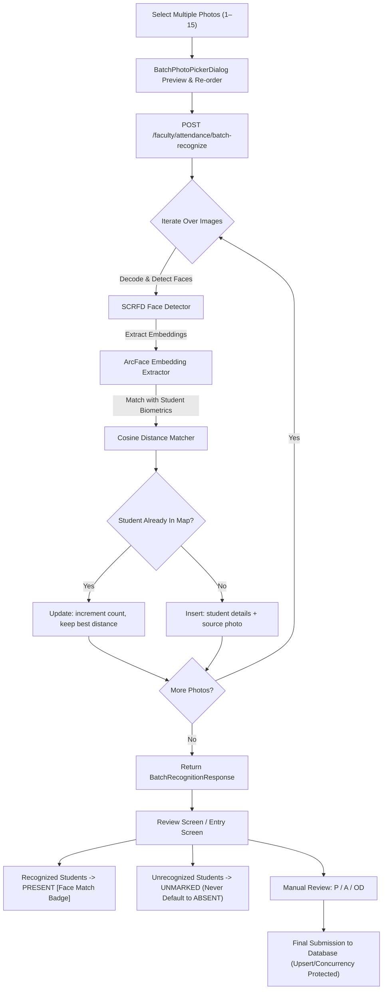

# PHASE 8 — BATCH PHOTO ATTENDANCE + RETROSPECTIVE ATTENDANCE REPORT

**Project:** Attendance Marker (`am-oss`)  
**Date:** October 6, 2026  
**Branch:** `feat/phase-8-batch-photo-retrospective-attendance`  
**Status:** COMPLETE & VERIFIED (100% Tests Passing, Release APK Built)

---

## 1. Executive Summary

Phase 8 introduces production-grade **Batch Photo Attendance** and **Retrospective Attendance** across both Faculty and Class Advisor roles:
1. **Multi-Image Selection & Batch Upload:** Faculty and Class Advisors can select 1, 2, 5, 10, or up to 15 photos in a single operation via camera or device gallery (`pickMultiImage`).
2. **Unified ArcFace/SCRFD Batch Recognition Engine:** Reuses the existing biometric recognition pipeline (`RecognitionEngineFactory.get_engine()`) without introducing redundant engine abstractions. Processes each photo sequentially, tolerating individual photo decoding failures without aborting the entire batch.
3. **Student Deduplication & Evidence Aggregation:** When a student appears in multiple photos across the batch, their records are merged by `student_id` / `roll_number`. The system aggregates the evidence count (`recognized_in_photos_count`), stores the lowest cosine distance / highest confidence, and tracks source image filenames.
4. **UNMARKED Status Safety Rule Preserved:** Recognized students default to `PRESENT` with a visual recognition evidence badge (`[Face Match]`). Students who were **not** recognized remain strictly `UNMARKED`—they are **never** defaulted to `ABSENT`. Faculty / Class Advisors retain full manual review controls to toggle `P`, `A`, or `OD`, and submission is blocked until every student is marked.
5. **Retrospective Attendance Parity:** Both Faculty and Class Advisors can mark attendance for past timetable teaching periods (`req_date <= today_date`). Future dates are strictly rejected (`400 Bad Request`). Institutional breaks (short morning break 10:50–11:10 and lunch 12:50–13:40) are strictly excluded from attendance marking and percentage denominators.

---

## 2. Architecture & API Endpoints

### 2.1 Backend Endpoints Added & Updated

| Method | Endpoint | Description | Auth / RBAC |
|---|---|---|---|
| `GET` | `/api/v1/faculty/attendance/periods-for-date?date=YYYY-MM-DD` | Returns scheduled timetable periods for a specific past/present date for the authenticated faculty member. | `faculty` |
| `GET` | `/api/v1/faculty/class-advisor/periods-for-date?date=YYYY-MM-DD` | Returns all timetable periods (P1–P7) and lunch break metadata for the advised class for a specific date. | `faculty` (must be designated Class Advisor) |
| `POST` | `/api/v1/faculty/attendance/batch-recognize` | Accepts multipart `files` (1 to 15 images) along with `timetable_entry_id` and `date`. Runs face recognition across all photos, deduplicates recognized students, and returns merged match results. | `faculty` or assigned `class_advisor` |
| `GET` | `/api/v1/faculty/attendance/available-periods` | Preserved existing Today / Yesterday periods endpoint with updated backend date validation. | `faculty` |
| `POST` | `/api/v1/faculty/attendance/submit` | Preserved upsert protection & concurrency handling (409) for past date attendance records. | `faculty` |
| `POST` | `/api/v1/faculty/class-advisor/attendance/submit` | Preserved upsert protection & concurrency handling (409) for class advisor submissions. | `faculty` (advisor) |

### 2.2 Date Validation Rules

- **Future Dates:** Any request with `date > today` is rejected with HTTP 400 (`Attendance cannot be marked or retrieved for future dates: YYYY-MM-DD`).
- **Past Dates:** Any date with `date <= today` is accepted if the day of week matches the scheduled timetable slot.
- **Timetable Teaching Periods:** Teaching periods are strictly P1 through P7.
- **Lunch & Breaks:** Morning break (10:50–11:10) and Lunch (12:50–13:40) are strictly non-selectable and excluded from attendance marking.

---

## 3. Batch Recognition Workflow & Data Contracts

### 3.1 Flow Diagram



### 3.2 Request Contract (`POST /api/v1/faculty/attendance/batch-recognize`)

- **Content-Type:** `multipart/form-data`
- **Fields:**
  - `timetable_entry_id`: `int` (e.g. `160`)
  - `date`: `str` (e.g. `"2026-10-05"`)
  - `files`: `List[UploadFile]` (1 to 15 image files)

### 3.3 Response Contract (`BatchRecognitionResponse`)

```json
{
  "total_photos_processed": 3,
  "successful_photos_count": 3,
  "failed_photos_count": 0,
  "photo_summaries": [
    {
      "photo_index": 0,
      "filename": "row1_front.jpg",
      "detected_faces_count": 8,
      "recognized_students_count": 8,
      "status": "SUCCESS"
    },
    {
      "photo_index": 1,
      "filename": "row2_middle.jpg",
      "detected_faces_count": 12,
      "recognized_students_count": 11,
      "status": "SUCCESS"
    },
    {
      "photo_index": 2,
      "filename": "row3_back.jpg",
      "detected_faces_count": 10,
      "recognized_students_count": 9,
      "status": "SUCCESS"
    }
  ],
  "unique_recognized_students_count": 25,
  "recognized_students": [
    {
      "student_id": 101,
      "roll_number": "721023149001",
      "name": "Aarav Kumar",
      "best_distance": 0.285,
      "best_confidence": 0.857,
      "recognized_in_photos_count": 2,
      "source_photos": ["row1_front.jpg", "row2_middle.jpg"]
    }
  ],
  "errors": []
}
```

---

## 4. Flutter Mobile Implementation

### 4.1 UI Components & Screen Updates

1. **`BatchPhotoPickerDialog` (`mobile/lib/faculty/widgets/batch_photo_picker_dialog.dart`)**:
   - Reusable modal dialog featuring multi-photo selection via `ImagePicker.pickMultiImage()`.
   - Grid preview showing thumbnail images with individual delete ("X") buttons.
   - Counter chip displaying `Photos: N / 15`.
   - Single-tap Camera add option and Gallery multi-select option.
   - In-dialog recognition progress state with spinner and informative status text.
2. **`FacultyAttendanceEntryScreen` (`mobile/lib/faculty/screens/faculty_attendance_entry_screen.dart`)**:
   - Added `Batch Photos` button directly in the action bar.
   - Integrated `BatchPhotoPickerDialog` callback:
     - Automatically marks recognized students as `PRESENT`.
     - Preserves `UNMARKED` status for students not present in any photo.
     - Attaches recognition badge: `Face Match (N photos, d=0.XX)`.
     - Displays summary banner notifying faculty of match count: `Batch Recognition: X student(s) recognized across Y photo(s)`.
3. **`FacultyClassAdvisorEntryScreen` (`mobile/lib/faculty/screens/faculty_class_advisor_entry_screen.dart`)**:
   - Full feature parity for Class Advisors marking attendance across all timetable periods of their advised class.
   - Includes `Batch Photos` button and recognition evidence badges.
4. **`FacultyAttendanceScreen` (`mobile/lib/faculty/screens/faculty_attendance_screen.dart`)**:
   - Upgraded to 3-tab navigation: `TODAY`, `YESTERDAY`, `PAST DATES`.
   - `PAST DATES` tab includes date picker, timetable period loader for the selected date, and schedule cards.
5. **`FacultyClassAdvisorScreen` (`mobile/lib/faculty/screens/faculty_class_advisor_screen.dart`)**:
   - Upgraded to 3-tab navigation: `TODAY`, `YESTERDAY`, `PAST DATES`.
   - Loads advised class periods for any past calendar date.
   - Displays lunch break metadata card reminding advisor of the uncounted institutional break.
   - Includes quick-action button: `View Daily Half-Day Summary for this date`.

---

## 5. Verification Results

### 5.1 Backend Automated Tests (`pytest`)
- **Suite:** `tests/test_phase8_batch_and_retrospective.py`
- **Result:** **10 / 10 PASSED (100%)**
  - `test_01_faculty_periods_for_past_date`: PASSED
  - `test_02_faculty_periods_for_future_date_rejected`: PASSED (Returns 400 Bad Request)
  - `test_03_class_advisor_periods_for_past_date`: PASSED
  - `test_04_class_advisor_future_date_rejected`: PASSED (Returns 400 Bad Request)
  - `test_05_class_advisor_non_advisor_rejected`: PASSED (Returns 403 Forbidden)
  - `test_06_retrospective_attendance_submission_and_upsert`: PASSED
  - `test_07_future_date_rejected_in_batch`: PASSED
  - `test_08_day_mismatch_rejected_in_batch`: PASSED
  - `test_09_empty_files_rejected`: PASSED
  - `test_10_batch_recognition_partial_failure_tolerance`: PASSED

### 5.2 Frontend Automated Tests (`flutter test`)
- **Suite:** Complete Mobile Test Suite (117 tests across auth, timetable, unmarked attendance, faculty windows, and advisors)
- **Result:** **117 / 117 PASSED (100%)**
- **Analysis:** `flutter analyze` completed with **0 errors and 0 warnings** ("No issues found!").

### 5.3 Release APK Build
- **Target:** Android Release APK
- **Command:** `flutter build apk --release`
- **Output:** `build\app\outputs\flutter-apk\app-release.apk` (54.7 MB)
- **Status:** Built successfully with all Phase 8 components bundled.

---

## 6. Summary of Changed Files

```
app/
  api/
    __init__.py                             (Mounted faculty_batch_recognition_router)
    faculty.py                              (Added periods-for-date & advisor periods-for-date)
    faculty_recognition.py                  (Added /batch-recognize endpoint & multi-photo processing)
  engines/
    attendance_engine.py                    (Added retrospective date validation & period lookup)
  schemas/
    faculty_attendance.py                   (Added BatchRecognizedStudent, BatchRecognitionResponse, etc.)
mobile/
  lib/
    core/config/api_config.dart             (Added batch recognize and periods-for-date routes)
    models/faculty_attendance_model.dart    (Added models for batch recognition & past periods)
    services/faculty_service.dart           (Added batchRecognizePhotos & periods-for-date methods)
    faculty/
      widgets/
        batch_photo_picker_dialog.dart      (Created multi-image picker dialog)
      screens/
        faculty_attendance_screen.dart      (Added PAST DATES tab & date picker)
        faculty_attendance_entry_screen.dart(Integrated batch photo recognition & evidence badge)
        faculty_class_advisor_screen.dart   (Added PAST DATES tab & advisor schedule view)
        faculty_class_advisor_entry_screen.dart (Integrated batch photo recognition for advisor)
  test/
    security_and_consistency_test.dart      (Updated mock FacultyService)
    timetable_ux_test.dart                  (Updated mock FacultyService)
tests/
  test_phase8_batch_and_retrospective.py    (10 comprehensive backend test cases)
```
