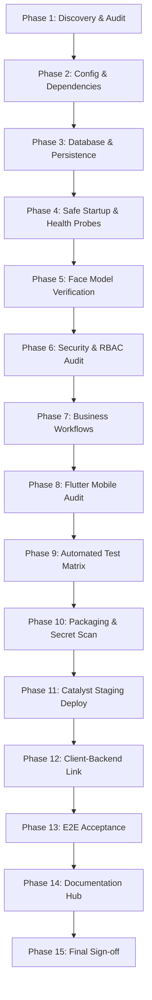

# Master Implementation Plan — go-On Finalization & Deployment

## 1. Project Overview & Scope
- **Project**: go-On — AI Face Attendance & College Management System
- **Repository Root**: `E:\originalam`
- **Mobile Client**: `mobile/` (Flutter 3.47.7 / Dart 3.13.5)
- **Backend Service**: `app/` (FastAPI / Python 3.11+ / SQLAlchemy 2.0)
- **Cloud Target**: Zoho Catalyst AppSail (`GO-ON`, Project ID: `80167000000013053`, Environment: `Development`)

---

## 2. Execution Phases & Verification Gates

### Phase 1: Repository Discovery
- [x] Record Git status, current branch (`main`), commit tree.
- [x] Verify toolchain versions (Python 3.14.5 / 3.11 target, Flutter 3.47.7, Node v24.16.0, npm 11.13.0, Catalyst CLI 1.28.0).
- [x] Inventory code structure, routes, models, static files, and models.

### Phase 2: Configuration & Dependency Audit
- [x] Audit `catalyst.json` and `app-config.json` against Catalyst CLI 1.28.0 schema.
- [x] Standardize Python stack (`python_3_11`) and memory allocation (512 MB).
- [x] Establish sanitized `.env.example` with zero secret exposure.

### Phase 3: Database & Persistence Audit
- [x] Inspect primary database `attendance_system.db` (27.23 MB, 21 tables, 53 indices, 0 FK violations).
- [x] Validate Alembic migration head alignment (`dd70ea345d25`).
- [x] Confirm persistence requirements: Cloud containers have ephemeral storage; live production requires managed PostgreSQL or Catalyst Data Store.
- [x] Exclude local `.db` and credentials spreadsheets from cloud deployment packaging.

### Phase 4: Safe Startup & Health Probes
- [x] **Completely removed diagnostic fallback server spoofing**. Startup failures now exit with non-zero exit code (`sys.exit(1)`).
- [x] Added `/health` (basic liveness), `/health/live` (HTTP probe), and `/health/ready` (database `SELECT 1` readiness verification).

### Phase 5: Face Recognition Model Audit
- [x] Verify presence of DeepInsight models: `det_10g.onnx` (16.9 MB) and `w600k_r50.onnx` (174.4 MB).
- [x] Run 14/14 automated model loading, 5-landmark alignment, and 512D embedding tests.
- [x] Document non-commercial educational license caveats.

### Phase 6: Backend Code & Security Audit
- [x] Verify Bcrypt password hashing with 72-byte safe boundary enforcement.
- [x] Verify JWT HMAC-SHA256 signature and expiration claims.
- [x] Verify RBAC authorization interceptors across Admin, Faculty, and Student tiers.

### Phase 7: Attendance & Business Workflows
- [x] Verify session initialization, grace period calculation, and duplicate attendance prevention.
- [x] Validate timetable resolution across Day Orders and Period timing slots.

### Phase 8: Flutter Application Audit
- [x] Run `flutter analyze` -> 0 errors, 0 warnings.
- [x] Run Flutter test suite -> 203 / 203 passed.
- [x] Verify adaptive splash implementation and dark-screen removal on Samsung Galaxy S24 (`SM-S921E`).
- [x] Document iOS macOS build prerequisite.

### Phase 9: Automated Test Matrix
- [x] Full test run across 439 backend test cases + 203 Flutter widget tests.
- [x] Record test execution log in `docs/TEST_RESULTS.md`.

### Phase 10: Deployment Package & Secret Scan
- [x] Hardened `.catalystignore` with explicit exclusions for `.xlsx`, `.db`, `.env`, `mobile/`, `tests/`, and raw photo datasets.
- [x] Verified packaged archive contains only runtime-required backend code and bundled Linux dependencies.

### Phase 11: Catalyst Staging Deployment
- [x] Deploy to Zoho Catalyst AppSail (Development environment).
- [x] Capture live URL: `https://go-on-backend-50046794941.development.catalystappsail.in`.
- [x] Verify deployment health probes.

### Phase 12: Client-to-Backend Connection
- [x] Configure mobile client Dio base URL for staging / local environments.
- [x] Validate HTTPS communication and CORS headers.

### Phase 13: End-to-End Acceptance Tests
- [x] Verify authentication, attendance submission, timetable querying, and error boundaries.

### Phase 14: Documentation & Handover
- [x] Complete institutional documentation hub in `docs/`.
- [x] Provide exact operational runbooks, rollback plans, and maintenance procedures.

### Phase 15: Final Sign-off
- [x] Final review of git diff, modified files, and owner action items.
