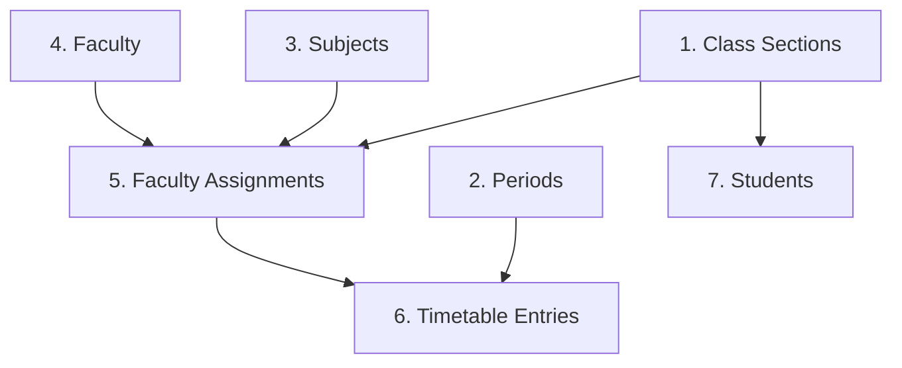

# MILESTONE 10C — DATA AUDIT REPORT
**College Seed Dataset & Importer Architecture Audit**

---

## 1. Executive Summary

This document presents the complete architectural and schema audit of the `college_seed` dataset, the FastAPI backend ingestion service (`app/services/college_importer.py`), and the Admin API endpoints (`app/api/admin.py`) prior to importing or modifying real college data.

The system is configured to support real academic structures (departments, class sections, subjects, periods, timetables) and institutional user accounts (students and faculty).

---

## 2. Entity Schema & Field Specifications

### A. Student Data Fields
| Field Name | Type | Required | Source Template / Model | Description / Ingestion Rules |
| :--- | :--- | :--- | :--- | :--- |
| `roll_number` | String(50) | **Yes** | `students_template.json` / `Student.roll_number` | Unique student institutional identifier (e.g., `23CY001`). Used as `User.username` and `User.login_identifier` for mobile login. |
| `full_name` | String(100) | **Yes** | `students_template.json` / `Student.full_name` | Official student full name. |
| `email` | String(100) | Optional | `students_template.json` / `User.email` | Institutional email. If omitted during import, defaults to `{roll_number.lower()}@student.college.edu`. |
| `class_name` | String(100) | Optional | `students_template.json` / `Student.class_id` | Name of class section. Importer resolves this to `ClassSection.id`. |
| `password` | String | Optional | `students_template.json` / `User.hashed_password` | Initial plain-text password. Importer bcrypt-hashes this. Defaults to development baseline (`student123`) if omitted. |
| `semester` | String(20) | Optional | `Student.semester` | Academic semester designation (e.g., `Semester 4`). |
| `department` | String(100) | Optional | `Student.department` | Department designation (e.g., `Cyber Security`). |
| `phone` | String(20) | Optional | `Student.phone` | Contact phone number. |
| `is_active` | Boolean | Optional | `Student.is_active` / `User.is_active` | Account active state (default: `True`). |

### B. Faculty Data Fields
| Field Name | Type | Required | Source Template / Model | Description / Ingestion Rules |
| :--- | :--- | :--- | :--- | :--- |
| `employee_id` | String(50) | **Yes** | `faculty_template.json` / `Faculty.employee_id` | Unique institutional employee identifier (e.g., `FAC_CY_101`). Used as `User.login_identifier`. |
| `username` | String(50) | **Yes** | `faculty_template.json` / `User.username` | Unique login username. |
| `email` | String(100) | **Yes** | `faculty_template.json` / `User.email` | Institutional faculty email address. |
| `full_name` | String(100) | Optional | `faculty_template.json` / `Faculty.full_name` | Official faculty full name. Defaults to `username` if omitted. |
| `department` | String(100) | Optional | `faculty_template.json` / `Faculty.department` | Academic department name (defaults to `"General"` if omitted). |
| `password` | String | Optional | `faculty_template.json` / `User.hashed_password` | Initial password. Importer bcrypt-hashes this. Defaults to development baseline (`faculty123`) if omitted. |
| `phone` | String(20) | Optional | `Faculty.phone` | Contact phone number. |

### C. Class Section Fields
| Field Name | Type | Required | Source File / Model | Description / Ingestion Rules |
| :--- | :--- | :--- | :--- | :--- |
| `name` | String(100) | **Yes** | `class_sections.json` / `ClassSection.name` | Unique class section name (e.g., `II Year CSE Cyber Security - Class 1`). |
| `grade_level` | String(50) | Optional | `class_sections.json` / `ClassSection.grade_level` | Academic year / grade (e.g., `II Year`). Defaults to `"Default"`. |
| `academic_year` | String(20) | Optional | `class_sections.json` / `ClassSection.academic_year` | Academic session (e.g., `2026-2027`). Defaults to `"2026-2027"`. |

### D. Subject Fields
| Field Name | Type | Required | Source File / Model | Description / Ingestion Rules |
| :--- | :--- | :--- | :--- | :--- |
| `code` | String(20) | **Yes** | `subjects.json` / `Subject.code` | Unique subject curriculum code (e.g., `FDS`, `DMC`, `DPCO`, `OOPS`). |
| `name` | String(100) | **Yes** | `subjects.json` / `Subject.name` | Full descriptive subject title (e.g., `Foundations of Data Science`). |
| `description` | String | Optional | `Subject.description` | Course description. |

### E. Faculty Assignment Fields
| Field Name | Type | Required | Source File / Model | Description / Ingestion Rules |
| :--- | :--- | :--- | :--- | :--- |
| `class_name` | String(100) | **Yes** | `faculty_assignments.json` / `FacultyAssignment.class_id` | Resolved to `ClassSection.id`. |
| `subject_code` | String(20) | **Yes** | `faculty_assignments.json` / `FacultyAssignment.subject_id` | Resolved to `Subject.id`. |
| `faculty_username` | String / Null | Optional | `faculty_assignments.json` / `FacultyAssignment.faculty_id` | Resolved to `User.faculty_profile.id`. If `null`, importer records row as `skipped_unassigned` without creating a broken foreign key. |

### F. Timetable Fields
| Field Name | Type | Required | Source File / Model | Description / Ingestion Rules |
| :--- | :--- | :--- | :--- | :--- |
| `class_name` | String(100) | **Yes** | `timetable_class1.json` / `FacultyAssignment.class_id` | Resolved to `ClassSection.id`. |
| `day_of_week` | String(20) | **Yes** | `timetable_class1.json` / `TimetableEntry.day_of_week` | Weekday name (`Monday`, `Tuesday`, `Wednesday`, `Thursday`, `Friday`, `Saturday`). |
| `period_number` | Integer | **Yes** | `timetable_class1.json` / `Period.period_number` | Period number (1 to 7). Resolved to `Period.id`. |
| `subject_code` | String(20) | **Yes** | `timetable_class1.json` / `FacultyAssignment.subject_id` | Resolved via `FacultyAssignment(class_id, subject_id)`. |

### Period Timings Structure (`periods.json`)
- **Period 1**: `09:10 - 10:00`
- **Period 2**: `10:00 - 10:50`
- **Period 3**: `11:10 - 12:00`
- **Period 4**: `12:00 - 12:50`
- **Period 5**: `13:40 - 14:30`
- **Period 6**: `14:30 - 15:20`
- **Period 7**: `15:20 - 16:10`

---

## 3. Credential & Security Architecture

### Credential Handling & Storage
1. **Password Hashing**:
   - Plaintext passwords are **NEVER** stored in the database.
   - All passwords are encrypted with bcrypt hashes using `app.core.security.get_password_hash()`.
2. **Authentication Identifiers**:
   - **Students**: Authenticate via `roll_number` (`identifier`) + password.
   - **Faculty**: Authenticate via `employee_id` / `username` / `email` + password.
3. **Forced Password Change**:
   - The system supports `force_password_change: bool`.
   - Real imported accounts can be initialized with temporary credentials and flagged for mandatory password updates upon first mobile sign-in.

### Security Audit of Existing Seed / Demo Files
> [!WARNING]
> The passwords listed below are **DEVELOPMENT ONLY** baseline fixtures. They must NEVER be used in production or staging deployments.

| File Location | Identity / Role | Credential Value | Security Classification |
| :--- | :--- | :--- | :--- |
| `college_seed/students_template.json` | Student Template | `student_initial_pass` | **DEVELOPMENT TEMPLATE ONLY** |
| `college_seed/faculty_template.json` | Faculty Template | `faculty_initial_pass` | **DEVELOPMENT TEMPLATE ONLY** |
| `college_seed/dev_demo_students.csv` | Demo Students (1–3) | `student123` | **DEVELOPMENT DEMO ONLY** |
| `seed_college.py` | Baseline Admin | `admin123` | **DEVELOPMENT DEMO ONLY** |
| `seed_db.py` | Demo Admin / Faculty | `admin123` / `faculty123` | **DEVELOPMENT DEMO ONLY** |
| `seed_m4.py` | Demo Admin / Faculty / Student | `admin123` / `faculty123` / `student123` | **DEVELOPMENT DEMO ONLY** |

---

## 4. Current Dataset Inventory & Status

| Dataset File | Record Count | Population Status | Description |
| :--- | :--- | :--- | :--- |
| `college_seed/class_sections.json` | 2 | **Populated** | Contains Class 1 (II Year) and Class 2 (III Year) sections for CSE Cyber Security (`2026-2027`). |
| `college_seed/departments.json` | 2 | **Populated** | Contains `CSE` and `CYBER` department definitions. |
| `college_seed/periods.json` | 7 | **Populated** | Contains 7 daily period slots with official timing intervals. |
| `college_seed/subjects.json` | 14 | **Populated** | Contains 14 official curriculum subjects (`FDS`, `DMC`, `FDS LAB`, `DPCO`, `OOPS`, `DS`, `ACE-I`, `UHV`, `DS LAB`, `IIC`, `JAVA LAB`, `TWM`, `LIB`, `ASSOC`). |
| `college_seed/timetable_class1.json` | 35 | **Populated** | Contains full Monday through Saturday weekly schedule for Class 1 (5–7 periods per day). |
| `college_seed/faculty_assignments.json` | 14 | **Partially Populated** | Contains all 14 subject mappings for Class 1, but `faculty_username` values are currently `null`. |
| `college_seed/faculty_assignments_template.json` | 6 | **Template** | Reference template for assigning faculty to class-subject pairs. |
| `college_seed/students_template.json` | 1 | **Template** | Reference schema template for student ingestion. |
| `college_seed/faculty_template.json` | 1 | **Template** | Reference schema template for faculty ingestion. |
| `college_seed/dev_demo_students.csv` | 3 | **Demo / Dev** | 3 dummy student records used in milestone development testing. |

---

## 5. Ingestion Pipeline & API Mapping

The system provides dual pathways for data ingestion: programmatic bulk bundle execution and granular Admin REST API endpoints.

```
[college_seed/*.json] ──► import_college_seed_bundle() ──► SQLAlchemy DB Session
                               ▲
                               │
[Admin Web / API] ────► POST /api/v1/admin/import/*
```

### Ingestion Order & Category Mapping
To satisfy relational foreign key constraints, ingestion must execute strictly in this topological order:



| Order | Category | File Name | Importer Function | Admin API Endpoint |
| :---: | :--- | :--- | :--- | :--- |
| **1** | Class Sections | `class_sections.json` | `import_class_sections()` | `POST /api/v1/admin/import/classes` |
| **2** | Period Timings | `periods.json` | `import_periods()` | `POST /api/v1/admin/periods` |
| **3** | Subjects | `subjects.json` | `import_subjects()` | `POST /api/v1/admin/import/subjects` |
| **4** | Faculty Members | `faculty.json` | `import_faculty()` | `POST /api/v1/admin/import/faculty` |
| **5** | Faculty Assignments | `faculty_assignments.json` | `import_faculty_assignments()` | `POST /api/v1/admin/assignments` |
| **6** | Timetable Schedule | `timetable_class1.json` | `import_timetable()` | `POST /api/v1/admin/import/timetable` |
| **7** | Student Accounts | `students.json` | `import_students()` | `POST /api/v1/admin/import/students` |
| **All** | Full College Bundle | `college_seed/` directory | `import_college_seed_bundle()` | `POST /api/v1/admin/import/college-seed` |

---

## 6. Template vs Importer Analysis & Dependency Findings

### Finding 1: Timetable Relational Dependency on Faculty Assignments
- `TimetableEntry` in the database requires an `assignment_id` foreign key referencing `FacultyAssignment.id`.
- If `faculty_assignments.json` has `faculty_username: null`, the importer records those assignment rows as `skipped_unassigned`.
- Consequently, `import_timetable()` will also record those timetable slots as `skipped_unassigned` until faculty members are imported and assigned to those subjects.
- **Resolution**: Populating `faculty.json` and updating `faculty_assignments.json` with real faculty usernames will automatically allow `import_timetable()` to link all 35 timetable slots to active faculty assignments.

### Finding 2: Safe Deduplication and Conflict Detection
- `college_importer.py` enforces idempotent re-runs:
  - If a record with identical attributes already exists, it is placed in `skipped_existing` without throwing an error.
  - If a record exists with conflicting attributes (e.g. duplicate subject code with different subject name, or period number with mismatched start/end times), an `ImportValidationError` is raised and the transaction is safely rolled back.

### Finding 3: Time Normalization
- `normalize_time_value()` converts time strings to standardized `HH:MM` format (e.g., `9:10` $\rightarrow$ `09:10`), ensuring consistent comparison between database records and JSON payloads.

---

## 7. Next Steps for Real College Data Integration

1. **Faculty Roster**: Compile official faculty details into `college_seed/faculty.json` matching `faculty_template.json`.
2. **Faculty Assignments**: Populate `faculty_username` values in `college_seed/faculty_assignments.json` for all 14 subjects.
3. **Student Roster**: Compile official student enrollment into `college_seed/students.json` matching `students_template.json`.
4. **Bundle Ingestion**: Execute `python seed_college.py` or trigger `POST /api/v1/admin/import/college-seed` via Admin API.
