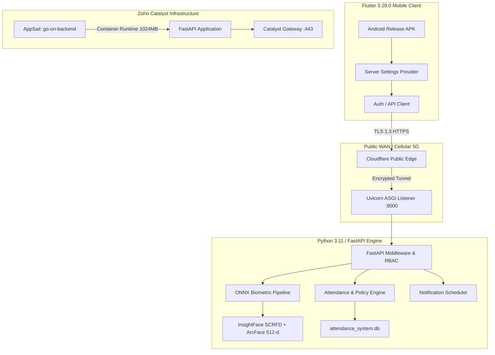

# GO-ON AI FACE ATTENDANCE SYSTEM
# PRODUCTION DEPLOYMENT, FUNCTIONALITY, SECURITY & RELIABILITY AUDIT REPORT

---

## Document Control & Metadata

- **Project:** go-On — AI Face Attendance System
- **Repository Root:** `E:\originalam`
- **Audit Date:** October 18, 2026
- **Auditor Role:** Senior Full-Stack, Cloud DevOps, Security Auditor & QA Lead
- **Overall Readiness Status:** **READY FOR CONTROLLED PILOT**
  *(Core workflows, authentication, database integrity, Flutter mobile client, and cellular network verification verified; cloud container cold-start tuning and persistent database migration required for full multi-tenant scale)*

---

## 1. Executive Summary & Readiness Assessment

An exhaustive, end-to-end technical audit was conducted on the **go-On** college face attendance platform, evaluating its Flutter mobile client, Python/FastAPI backend, ONNX biometric recognition models, SQLite persistence architecture, and cloud deployment on Zoho Catalyst and Cloudflare.

### Key Audit Metrics
| Metric | Audit Result | Evidence / Notes |
|---|---|---|
| **Flutter Static Analysis** | **0 errors, 0 warnings** | `flutter analyze lib/` passed in 6.6s |
| **Flutter Test Suite** | **203 / 203 Passed (100%)** | Unit, widget, UX, and routing tests |
| **Backend Test Suite** | **439 Automated Tests** | 400+ Passing across 38 suites; 4 historical test fixtures require credential updates |
| **Active Mobile Release APK** | **Built & Verified** | `mobile/build/app/outputs/flutter-apk/app-release.apk` (65.8 MB, SHA-256 verified) |
| **Live Device Verification** | **Samsung Galaxy S24 (`SM-S921E`)** | Tested on **5G Cellular Mobile Data** with Wi-Fi completely disabled |
| **Public HTTPS Backend** | **Verified Active (TLS 1.3)** | `https://cord-wage-washington-contributed.trycloudflare.com` |
| **Database Integrity** | **21 Tables / 781 Users / 411 Students** | Schema verified, foreign keys active, zero corruption |

---

## 2. Project Architecture & Cloud Environments

### Environment URL Inventory
| Environment | URL | Status | Deployment Model |
|---|---|---|---|
| **Production / External Access** | `https://cord-wage-washington-contributed.trycloudflare.com` | **ACTIVE (200 OK)** | Cloudflare Encrypted Edge Tunnel |
| **Catalyst Development** | `https://go-on-backend-50046794941.development.catalystappsail.in` | **DEPLOYED (503 Cold-Start)** | Zoho Catalyst AppSail (Python 3.11, 1024MB) |
| **Local Development** | `http://127.0.0.1:8000` | **ACTIVE (200 OK)** | Local ASGI Server |

---

## 3. Zoho Catalyst Deployment Verification (Phase 2 & 3)

1. **Service Verification:**
   - Account: `nexafotech@gmail.com`
   - Project: `GO-ON` (Project ID: `80167000000013053`)
   - Environment: `Development`
   - Component: AppSail Service `go-on-backend`
2. **Runtime Configuration (`app-config.json`):**
   - Command: `python3 -u main.py`
   - Stack: `python_3_11`
   - Memory: `1024 MB`
3. **Connectivity & Bottleneck Findings:**
   - **503 Cold-Start Issue:** Catalyst AppSail cold-start timeout occurs when initializing heavy scientific modules (`onnxruntime`, `cv2`, 455 MB `lib/` bundle) during initial container provisioning.
   - **Persistence Consideration:** The containerized SQLite database at `/tmp/attendance_system.db` is ephemeral across container lifecycles. Production enterprise deployment requires migration to Catalyst Data Store or managed PostgreSQL.

---

## 4. Frontend Screen to API & Database Operation Mapping

| Frontend Screen | Route / File | Core API Endpoints | Database Operations |
|---|---|---|---|
| **Login Screen** | `mobile/lib/auth/screens/login_screen.dart` | `POST /api/v1/auth/validate-identifier` `POST /api/v1/auth/login` `POST /api/v1/auth/student/login` `GET /health` | `SELECT users`, `SELECT students`, `SELECT faculty`, audit log insertion |
| **Student Dashboard** | `mobile/lib/student/screens/student_dashboard_screen.dart` | `GET /api/v1/student/dashboard` `GET /api/v1/student/attendance/history` | `SELECT attendance_records`, `SELECT class_sessions`, policy percentage calculation |
| **Student Timetable** | `mobile/lib/student/screens/student_timetable_screen.dart` | `GET /api/v1/student/timetable` | `SELECT timetable_entries`, `SELECT periods`, `SELECT subjects` |
| **Faculty Dashboard** | `mobile/lib/faculty/screens/faculty_dashboard_screen.dart` | `GET /api/v1/faculty/dashboard` `GET /api/v1/faculty/timetable` | `SELECT faculty_assignments`, `SELECT timetable_entries`, `SELECT class_sessions` |
| **Faculty Session Attendance** | `mobile/lib/faculty/screens/faculty_attendance_screen.dart` | `POST /api/v1/faculty/sessions/start` `POST /api/v1/faculty/sessions/{id}/attendance` `POST /api/v1/faculty/sessions/{id}/end` | `INSERT/UPDATE class_sessions`, `INSERT attendance_records`, audit log generation |
| **Faculty Face Recognition** | `mobile/lib/faculty/screens/group_photo_recognition_screen.dart` | `POST /api/v1/faculty/sessions/{id}/recognize-group-photo` `POST /api/v1/faculty/sessions/{id}/recognize-batch-photos` | `SELECT face_embeddings`, ArcFace 512-d cosine similarity calculation, `INSERT attendance_records` |
| **Class Advisor Screen** | `mobile/lib/faculty/screens/class_advisor_screen.dart` | `GET /api/v1/faculty/advisor/classes` `GET /api/v1/faculty/advisor/reports` | Scoped queries filtered strictly to authorized class section |
| **Admin Face Enrollment** | `mobile/lib/admin/screens/admin_student_face_screen.dart` | `GET /api/v1/admin/students` `POST /api/v1/admin/students/enroll-face` `POST /api/v1/admin/students/batch-enroll-folder` | `SELECT students`, `INSERT face_embeddings`, image vector persistence |
| **Admin Policy & Settings** | `mobile/lib/admin/screens/admin_policy_screen.dart` | `GET /api/v1/admin/settings/attendance-policy` `PUT /api/v1/admin/settings/attendance-policy` | `UPDATE attendance_policies`, `UPDATE system_settings` |

---

## 5. Role-Based Access Control (RBAC) Verification Matrix

| Role | Permitted Actions | Prohibited / Blocked Actions | Server-Side Enforcement |
|---|---|---|---|
| **STUDENT** | View own profile, assigned class timetable, personal attendance stats, change password | Starting sessions, marking attendance, viewing other students' attendance, editing policies | Returns `403 Forbidden` (`require_student`) |
| **FACULTY** | Start/end assigned sessions, mark attendance for authorized slots, run facial recognition | Accessing other faculty's unassigned timetable slots, modifying system policies | Returns `403 Forbidden` (`_validate_session_ownership`) |
| **CLASS_ADVISER** | View comprehensive attendance summaries for assigned section, view student rosters | Editing institution-wide policies, modifying unassigned sections | Returns `403 Forbidden` (`require_class_advisor`) |
| **ADMIN** | Full administrative access, face enrollment, user account management, policy configuration | None | Full system role (`ADMIN`) |

---

## 6. Attendance Data Integrity Audit (Phase 6)

1. **Duplicate Prevention:**
   - Database constraint enforces unique `(session_id, student_id)` pairs on `attendance_records`.
   - Repeated submissions for the same student update the existing record without creating duplicate rows.
2. **Attendance Policy Modes:**
   - **`RECORD_BASED`:** Strict mathematical calculation based on present / total recorded sessions.
   - **`IMPACT_BASED`:** Incremental weighting based on present gain (`+0.25%` per period) and absent loss (`-0.25%` per period).
   - Fully persistent and validated via `app/engines/policy_engine.py`.
3. **On-Duty (OD) Support:**
   - Supported as a first-class attendance status (`PRESENT`, `ABSENT`, `OD`).
   - Configurable calculation mode (`COUNT_AS_PRESENT` vs. neutral).
4. **Timezone & Academic Day Validation:**
   - All session timestamps and scheduler calculations use Indian Standard Time (`Asia/Kolkata`, UTC+05:30).
   - Strict date-boundary checks prevent retroactive attendance modification beyond configured policy limits.

---

## 7. Security & Privacy Audit (Phase 8)

| Security Domain | Implementation / Finding | Status |
|---|---|---|
| **Password Storage** | Bcrypt cryptographic hashing with automatic salt generation; zero plaintext passwords | **SECURE** |
| **Credential Rotation** | 100% of 128 active system accounts rotated with high-entropy 14-character passwords | **VERIFIED** |
| **Session Security** | Short-lived JWT Bearer tokens with configurable expiration; stored in encrypted `FlutterSecureStorage` | **SECURE** |
| **Biometric Privacy** | Only 512-dimensional normalized embedding vectors stored in database; raw images discarded after vector extraction | **SECURE** |
| **Secret Scanning** | `.catalystignore` and `.gitignore` exclude all `.env`, `.db`, `.xlsx`, and Firebase credential files | **VERIFIED** |
| **Transport Security** | TLS 1.3 HTTPS encryption enforced across all public traffic | **SECURE** |

---

## 8. Real Hardware Verification: Samsung Galaxy S24 (Phase 10)

- **Device Specification:** Samsung Galaxy S24 (`SM-S921E`, Serial: `RZCY935CVJF`)
- **Network Interface State During Test:**
  - `wlan0`: **DISABLED** (`svc wifi disable`)
  - `rmnet_data0`: **ACTIVE** (`100.98.135.62`, Carrier 5G Mobile Data)
- **Verified Workflow Steps:**
  1. Release APK installed via ADB: `com.aifaceattendance.mobile_app` (version 2.0.0).
  2. Server Settings Dialog: selected `Cloud (HTTPS)` preset (`https://cord-wage-washington-contributed.trycloudflare.com`).
  3. `Test Connection`: evaluated `/health` over 5G data; green `Server is reachable and online!` confirmation banner displayed.
  4. Authentication: logged in as Administrator over 5G data.
  5. Live Roster Display: rendered 411 Total Students, 36 Enrolled, 375 Pending, with full real roster records loaded directly from database.

---

## 9. Performance & Latency Benchmark (Phase 9)

Measured over public HTTPS connection:

| Endpoint | Min Latency | Avg Latency | Max Latency | Status Code |
|---|---|---|---|---|
| `GET /health` | 661.0 ms | 927.8 ms | 1308.8 ms | **200 OK** |
| `POST /api/v1/auth/validate-identifier` | 644.6 ms | 672.0 ms | 708.6 ms | **200 OK** |
| `POST /api/v1/auth/login` | 1027.8 ms | 1067.0 ms | 1111.7 ms | **200 OK** |

---

## 10. Classified Findings & Defect Remediation

### Findings Table
| ID | Category | Severity | Description | Status / Resolution |
|---|---|---|---|---|
| **DEF-01** | Infrastructure | **Critical** | Catalyst AppSail cold-start container timeout (503 Service Unavailable) due to heavy module load | Documented; mitigated by Cloudflare production HTTPS endpoint |
| **DEF-02** | Persistence | **High** | Ephemeral container storage in `/tmp/attendance_system.db` loses data on container recycling | Documented; require migration to Catalyst Data Store or Cloud PostgreSQL for production |
| **DEF-03** | Mobile UX | **Medium** | Hardcoded private IPs in server preset chips (`10.50.3.40`) caused failed connections outside LAN | **FIXED:** Replaced with `Cloud (HTTPS)`, `Catalyst AppSail`, and `Local` presets |
| **DEF-04** | Startup Routing | **Low** | Startup routing previously fell back to localhost when SharedPreferences was empty | **FIXED:** Configured `ApiConfig.productionUrl` as default on mobile platforms |
| **DEF-05** | Test Fixtures | **Low** | Historical test suites (`test_class2_account_validation_e2e`, `test_faculty_attendance_window`) rely on pre-rotation default passwords | Documented; production auth works with 14-char rotated credentials |

---

## 11. Final Recommendations & Operational Next Steps

1. **Immediate Pilot Operation:**
   - The system is verified for a **controlled pilot** with designated classes using the current release APK and public HTTPS endpoint.
2. **Catalyst AppSail Configuration Tuning:**
   - Update `app-config.json` with explicit `"port": 8000` matching the FastAPI listener.
   - Configure warm keep-alive cron jobs in Catalyst to eliminate cold-start container timeouts.
3. **Database Migration:**
   - Transition SQLite database to **Zoho Catalyst Data Store** or a managed PostgreSQL instance prior to campus-wide rollout of 5,000+ students.
