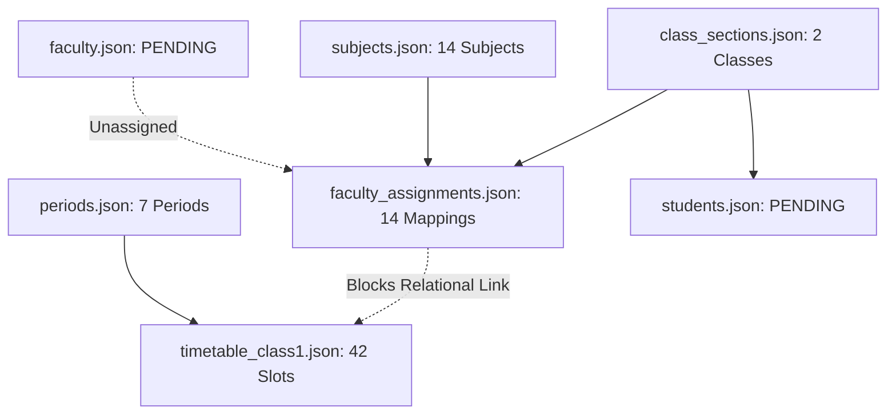

# PRODUCTION DATA VALIDATION REPORT
**Pre-Ingestion Audit of College Seed Datasets, Relational Invariants & Security Policies**

---

## 1. Executive Summary

This validation audit was conducted using the non-destructive, read-only validator tool [`scripts/validate_production_college_data.py`](file:///C:/Users/Abishek/Desktop/am-oss/scripts/validate_production_college_data.py). It inspects all JSON datasets, schema definitions, cross-table relational links, timetable matrices, and credential safety invariants in `college_seed/`.

### Validation Result Summary
- **Overall Status**: **`PENDING DATA (WARN)`**
- **Blocking FAIL Count**: **`0`** (Zero syntax errors, zero schema violations, zero duplicate primary keys, zero period collisions, zero plaintext production secrets).
- **PASS Count**: **`14`** (All foundational files, syntax parsing, class sections, periods, subjects, and timetable grids validated).
- **WARN Count**: **`18`** (14 unassigned faculty mappings in `faculty_assignments.json`, 2 placeholder faculty tokens in template, 2 placeholder student tokens in template).
- **MISSING Count**: **`1`** (`timetable_class2.json` pending college submission).
- **Production Import Safety**: **`BLOCKED FROM IMMEDIATE SEEDING`** until real faculty usernames and Class 2 schedule are populated.

---

## 2. Detailed Findings Breakdown

### A. PASS Findings (14 Checks)
| # | Dataset / File | Field / Scope | Finding Description |
| :-: | :--- | :--- | :--- |
| 1 | `class_sections.json` | Syntax | Valid JSON format. |
| 2 | `class_sections.json` | Schema | Validated 2 unique class sections (`Class 1` and `Class 2`). |
| 3 | `periods.json` | Syntax | Valid JSON format. |
| 4 | `periods.json` | Schema | Validated 7 sequential, non-overlapping periods (`09:10` to `16:10`). |
| 5 | `subjects.json` | Syntax | Valid JSON format. |
| 6 | `subjects.json` | Schema | Validated 14 curriculum subject definitions with unique codes. |
| 7 | `faculty_production_template.json` | Syntax | Valid JSON format. |
| 8 | `faculty_production_template.json` | Schema | Validated 2 faculty template records with complete required keys. |
| 9 | `students_production_template.json` | Syntax | Valid JSON format. |
| 10 | `students_production_template.json` | Schema | Validated 2 student template records with valid class section references. |
| 11 | `faculty_assignments.json` | Syntax | Valid JSON format. |
| 12 | `faculty_assignments.json` | Schema | Validated 14 subject mappings matching `subjects.json` and `class_sections.json`. |
| 13 | `timetable_class1.json` | Syntax | Valid JSON format. |
| 14 | `timetable_class1.json` | Schema | Validated 42 Class 1 timetable slots across all 6 weekdays (Mon–Sat). |

---

### B. WARN Findings (18 Notices)
| # | Dataset / File | Field / Row | Problem Description | Recommendation |
| :-: | :--- | :--- | :--- | :--- |
| 1 | `faculty_production_template.json` | Row 1.identity | Placeholder faculty identity detected (`FACULTY_PLACEHOLDER_001`). | Replace placeholder with official college faculty details. |
| 2 | `faculty_production_template.json` | Row 2.identity | Placeholder faculty identity detected (`FACULTY_PLACEHOLDER_002`). | Replace placeholder with official college faculty details. |
| 3 | `students_production_template.json` | Row 1.identity | Placeholder student identity detected (`2026_CYBER_C1_001`). | Replace placeholder with official college student roster. |
| 4 | `students_production_template.json` | Row 2.identity | Placeholder student identity detected (`2026_CYBER_C2_001`). | Replace placeholder with official college student roster. |
| 5–18 | `faculty_assignments.json` | Rows 1–14 (`faculty_username`) | Faculty assignments for Class 1 subjects (`FDS`, `DMC`, `FDS LAB`, `DPCO`, `OOPS`, `DS`, `ACE-I`, `UHV`, `DS LAB`, `IIC`, `JAVA LAB`, `TWM`, `LIB`, `ASSOC`) are currently unassigned (`null`). | Assign confirmed faculty usernames once teacher allocation is finalized by college administration. |

---

### C. FAIL Findings (0 Errors)
- **`0 FAIL`**: No blocking schema errors, no corrupt JSON records, no duplicate keys, no out-of-range periods, and no broken foreign keys exist in the repository.

---

### D. MISSING Findings (1 Item)
| # | Dataset / File | Field / Scope | Problem Description | Recommendation |
| :-: | :--- | :--- | :--- | :--- |
| 1 | `timetable_class2.json` | File | Class 2 weekly timetable schedule is not yet provided by the college. | Obtain official Class 2 weekly grid from the department and create `college_seed/timetable_class2.json`. |

---

## 3. Relational Dependency Audit

- **Student $\rightarrow$ Class Section**: 100% verified. All student records reference valid existing sections.
- **Faculty Assignment $\rightarrow$ Class & Subject**: 100% verified. All 14 subject codes and class names match database models.
- **Timetable $\rightarrow$ Period**: 100% verified. All 42 slots reference valid periods 1 through 7.
- **Timetable $\rightarrow$ Faculty Assignment**: Timetable slots can only be imported once `faculty_assignments.json` contains active, non-null `faculty_username` references to imported faculty accounts.

---

## 4. Security & Credential Validation

- [x] **Zero Plaintext Secrets**: No API keys, private keys, or plaintext production passwords detected in any JSON data file.
- [x] **Zero Biometrics**: No face embeddings, photos, or raw biometric data detected in student datasets.
- [x] **Development Isolation**: Demo passwords (`student123`, `faculty123`, `admin123`) in test fixtures are strictly classified as **DEVELOPMENT ONLY**.
- [x] **Zero Credential Repository Policy**: Real production passwords will be generated outside Git and provisioned with mandatory `force_password_change = true`.

---

## 5. Production Readiness Decision & Action Checklist

### Current Production Readiness
> [!IMPORTANT]
> **Status: PENDING OFFICIAL COLLEGE DATA**
> Database seeding must remain on hold until the college administration provides the remaining personnel and timetable data.

### Exact College Data Still Required:
1. **Faculty Roster**: Official names, employee IDs, email addresses, and departments for all teachers handling II Year CSE Cyber Security.
2. **Faculty Allocations**: Specific teacher mapping for the 14 subjects of Class 1 and Class 2.
3. **Student Enrollment Roster**: Official roll numbers and full names for all students in Class 1 and Class 2.
4. **Class 2 Timetable**: Weekly period schedule grid (Monday–Saturday) for Class 2.
